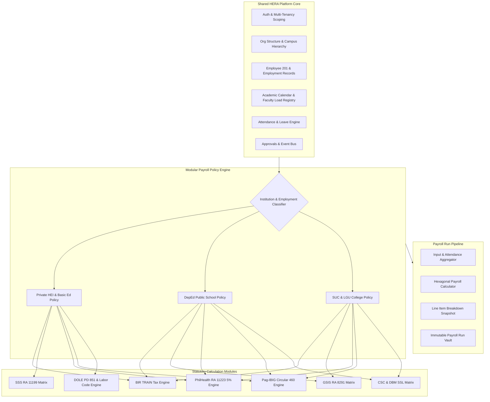
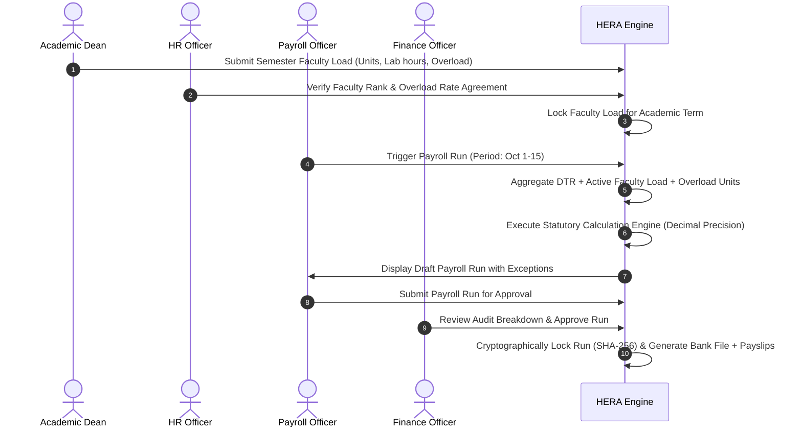
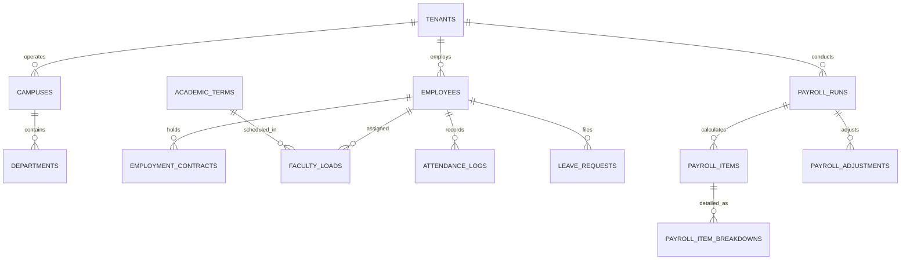
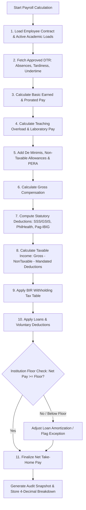
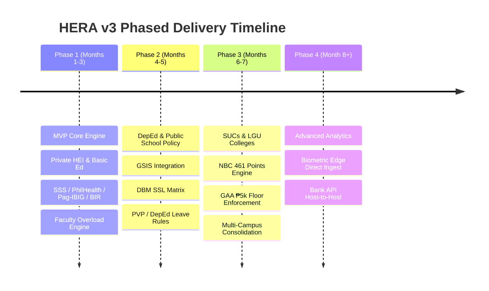

# HERA v3: Architecture and Implementation Plan
**Multi-Tenant HR and Payroll CMS for Philippine Educational Institutions**
*Target Repository: `edwardratunil/herav3`*

---

## 1. Product Vision, Boundaries, Assumptions & Decisions Needed

### 1.1 Product Vision
HERA v3 is a secure, multi-tenant cloud and shared-hosting-ready HR & Payroll management platform purpose-built for the Philippine educational ecosystem. It unifies the operational realities of academic management (teaching load units, laboratory multipliers, overload rates, faculty ranking, non-teaching schedules) with the strict statutory and institutional payroll requirements of Philippine private schools, DepEd schools, SUCs, and LGU colleges.

### 1.2 System Boundaries
- **In-Scope**:
  - Multi-tenant organizational management (Single-campus & Multi-campus).
  - Academic calendar, terms, school years, departments, faculty ranking, and academic workload (teaching load units, contact hours, overload calculations, substitutions, honoraria).
  - Full employee lifecycle: Onboarding, contract/appointment versioning, 201 filing system, attendance integration (manual & biometric imports), leave management (CSC Omnibus vs DOLE SIL), approvals workflow, and employee self-service (ESS).
  - Philippine statutory computations (BIR TRAIN withholding tax, SSS/GSIS, PhilHealth, Pag-IBIG), 13th-month pay, de minimis benefits, loan management, deductions, payslips, and payroll reconciliation.
  - Multi-role authorization, data privacy compliance (RA 10173), immutable payroll runs, cryptographic audit trails.
  - Optimized cPanel shared-hosting runtime (no persistent daemon, database queue/cache/session driver) with seamless migration path to VPS/cloud.
- **Out-of-Scope (for Initial Releases)**:
  - Direct banking protocol integration (ISO 20022/Host-to-Host SFTP) — standard encrypted bank payroll export files (BDO, BPI, Landbank, Metrobank) are supported instead.
  - Student Information Systems (SIS) and grading portals (integration supported via standard REST API / Webhooks).
  - Biometric hardware driver maintenance (attendance processed via CSV/Excel imports and REST ingest endpoints).

### 1.3 Labelled Assumptions
- `[ASSUMPTION-01]` **Shared Database Tenancy**: For maximum compatibility with standard cPanel hosting with restricted database quotas, a single-database multi-tenancy model with strict query-level tenant scoping (`tenant_id`) and Row-Level Security checks is optimal and scalable up to 250+ concurrent schools before requiring multi-database routing.
- `[ASSUMPTION-02]` **Bank Advice File Format**: Initial payroll disbursement will output standardized CSV/text formats compatible with major Philippine educational payroll banks (Landbank Findes/weAccess for public institutions; BDO, BPI BizLink, and Metrobank for private institutions).
- `[ASSUMPTION-03]` **Faculty Load Conversion**: Faculty members are compensated either under an hourly rate, a per-unit rate, or a fixed monthly basic with an overload premium when teaching units exceed the institutional baseline (e.g., 18 or 21 units per semester).
- `[ASSUMPTION-04]` **Statutory Rounding**: In accordance with Philippine accounting standards, all monetary figures are calculated with 4-decimal precision internally and rounded using `Half-Up` (`PHP_ROUND_HALF_UP`) to 2 decimal places at line-item and net pay levels.
- `[ASSUMPTION-05]` **Public Sector Net Take-Home Pay Floor**: Public institutions (DepEd/SUCs/LGU) must adhere to the General Appropriations Act (GAA) mandatory net take-home pay threshold (currently ₱5,000.00), preventing loan amortizations from deducting pay below this threshold.

### 1.4 Decisions Requiring User Input
1. **Pilot Institution Selection**: Do you approve starting the Phase 1 Pilot with a **Private Higher Education Institution (HEI) with a Basic Education Department**? (Recommended due to widespread adoption of SSS/DOLE/BIR rules and standard faculty load/overload formulas).
2. **Biometric Integration Priority**: Should the first attendance ingest prioritize standard ZKTeco CSV/DAT format or generic Excel templates?
3. **Approval Hierarchy Depth**: Should default leave and overload approval workflows support dynamic multi-tier authorization (e.g., Dept Chair -> College Dean -> HR -> VP Academics) or a configurable 2-tier workflow (Supervisor -> HR)?
4. **Target cPanel PHP Version**: Is PHP 8.2 or PHP 8.3 the baseline PHP version configured on your cPanel host?

---

## 2. Shared Platform Architecture & Institution-Specific Payroll Policy Design



### 2.1 Domain Separation Strategy
The platform utilizes a **Modular Hexagonal Architecture**:
1. **Core Domain (Shared)**: Personnel, contracts, organizational units, academic years, calendars, and attendance tracking are standardized across all institution types.
2. **Policy Contract (`PayrollPolicyInterface`)**: Defines explicit calculation contracts:
   - `calculateBasicPay(Contract, AttendanceSummary, AcademicLoad): Money`
   - `calculateOverloadAndHonoraria(FacultyLoad, PolicyConfig): Money`
   - `calculateStatutoryContributions(GrossTaxable, EmployeeCategory): StatutoryBreakdown`
   - `calculateWithholdingTax(TaxableIncome, YearToDateFigures): Money`
   - `applyDisallowancesAndCaps(GrossPay, Deductions, PolicyConfig): NetPayBreakdown`

### 2.2 Institution Type Matrix & Statutory Differences
| Dimension | Private Schools / Colleges | DepEd Public Schools | State Universities & Colleges (SUCs) / LGU |
| :--- | :--- | :--- | :--- |
| **Governing Law** | DOLE Labor Code of the Phils. | CSC Omnibus Rules; DepEd Orders | CSC Rules; DBM Budget Circulars; RA 8292 |
| **Salary Basis** | Institutional Board-approved scales; per-unit/hour rates | DBM Salary Standardization Law (SSL); Salary Grades & Steps | DBM SSL Grades/Steps + NBC 461/QCE Faculty Points |
| **Social Insurance** | **SSS** (RA 11199): 14.5% total (9.5% ER, 4.5% EE) up to ₱35,000 MSC + EC | **GSIS** (RA 8291): 9% EE, 12% ER based on actual monthly salary (no cap) | **GSIS** (RA 8291): 9% EE, 12% ER based on actual monthly salary |
| **Healthcare** | **PhilHealth** (RA 11223): 5% (2.5% EE, 2.5% ER) with ₱10k floor / ₱100k cap | **PhilHealth** (RA 11223): 5% (split 50/50 with government subsidy) | **PhilHealth** (RA 11223): 5% (split 50/50) |
| **Housing Fund** | **Pag-IBIG** (Circ. 460): 2% EE (₱200), 2% ER (₱200) baseline | **Pag-IBIG** (Circ. 460): ₱200 EE / ₱200 ER baseline | **Pag-IBIG** (Circ. 460): ₱200 EE / ₱200 ER baseline |
| **13th Month / Year-End** | Mandatory PD 851 (1/12th of basic salary earned) | Year-End Bonus (1 month basic) + Cash Gift (₱5,000) under DBM rules | Year-End Bonus (1 month basic) + Cash Gift (₱5,000) under DBM rules |
| **Vacation / Summer Pay** | Summer salary per contract terms (10-mo or 12-mo contracts) | Proportional Vacation Pay (PVP) based on DepEd school calendar | 15 days VL + 15 days SL or Teacher's Leave under CSC rules |
| **Special Allowances** | Institutional allowances, de minimis | PERA (₱2,000 non-taxable), Chalk Allowance (RA 11997) | PERA (₱2,000), RATA (for Deans/Execs), Honoraria (CHED) |
| **Deduction Threshold** | No statutory floor (must respect minimum wage laws) | Mandatory ₱5,000 net take-home pay threshold (GAA law) | Mandatory ₱5,000 net take-home pay threshold (GAA law) |

---

## 3. User Roles, Permissions & Key Workflows

### 3.1 Role Hierarchy & Separation of Duties
To guarantee compliance with Philippine auditing principles (COA for public, independent external audit for private), strict separation of duties is enforced:

1. **Platform Administrator (`super-admin`)**: Platform maintenance, tenant onboarding, subscription plans, global statutory matrix updates. Cannot view tenant employee PII or run school payroll.
2. **Institution Administrator (`tenant-admin`)**: Campus settings, department structure, role assignments, academic terms.
3. **HR Officer (`hr-officer`)**: Employee 201 records, contracts, onboarding, leave credits, disciplinary records.
4. **Academic Dean / Department Head (`academic-head`)**: Faculty teaching load approvals, overload assignments, substitutions, consultation logs.
5. **Attendance Officer (`timekeeper`)**: Shift scheduling, biometric attendance sync, DTR (Daily Time Record) verification, undertime/tardiness adjustments.
6. **Payroll Officer (`payroll-preparer`)**: Initializes payroll runs, generates draft computations, verifies adjustments and deductions. **Cannot approve own payroll runs**.
7. **Finance / Comptroller (`payroll-approver`)**: Reviews payroll computation, validates budget and bank totals, performs official approval and locking.
8. **Internal Auditor (`auditor`)**: Read-only access to historical payroll runs, immutable computation snapshots, and audit trail logs.
9. **Employee / Faculty (`employee`)**: Self-service portal (ESS): View DTR, file leaves, inspect teaching load assignments, download password-protected payslips, submit document requests.

### 3.2 Critical Workflows

#### Workflow A: Teaching Load to Payroll Computation


#### Workflow B: Leave Application to Payroll Impact
1. Faculty member files Sick Leave via ESS mobile/desktop interface.
2. Immediate Department Head receives push/in-app notification and approves.
3. HR validates available leave balances (CSC credits or DOLE SIL).
4. System automatically adjusts upcoming DTR period: marks hours as paid or unpaid leave without manual timekeeper intervention.

---

## 4. Proposed Modules, Database Entities & API Boundaries

### 4.1 Modular Structure
- `Modules/Tenancy`: Tenant registration, campus routing, domain resolution, feature flags.
- `Modules/Academic`: School years, semesters, departments, faculty ranks, teaching loads, course assignments.
- `Modules/Personnel`: 201 files, appointments, contracts, documents, dependent registry.
- `Modules/TimeAttendance`: DTR, biometric logs, shifts, holidays, leaves, undertime/tardiness calculation.
- `Modules/Payroll`: Payroll periods, batches, policy engines, statutory calculators, loans, adjustments, payouts.
- `Modules/Audit`: System audit trails, snapshot registries, cryptographic verification logs.

### 4.2 Database Entity-Relationship Model (Core Entities)



#### Key Schema Specifications:
- `tenants`: `id` (UUID), `code` (string), `name` (string), `institution_type` (`private_hei`, `private_k12`, `deped`, `suc`, `lgu`), `settings` (JSON), `created_at`.
- `campuses`: `id` (UUID), `tenant_id` (FK), `name`, `code`, `address`.
- `employees`: `id` (UUID), `tenant_id` (FK), `employee_number` (indexed), `first_name`, `last_name`, `tin`, `sss_no`, `gsis_no`, `philhealth_no`, `pagibig_no`, `tax_status`, `is_faculty` (boolean), `status`.
- `employment_contracts`: `id` (UUID), `tenant_id` (FK), `employee_id` (FK), `contract_type` (`regular`, `probationary`, `part_time`, `contractual`, `substitute`), `salary_basis` (`monthly`, `hourly`, `per_unit`), `base_rate` (`DECIMAL(12,4)`), `effective_date`, `expiry_date`.
- `faculty_loads`: `id` (UUID), `tenant_id` (FK), `employee_id` (FK), `academic_term_id` (FK), `regular_units` (`DECIMAL(5,2)`), `overload_units` (`DECIMAL(5,2)`), `lab_hours` (`DECIMAL(5,2)`), `hourly_rate` (`DECIMAL(10,4)`), `is_approved` (boolean).
- `payroll_runs`: `id` (UUID), `tenant_id` (FK), `period_start` (date), `period_end` (date), `payout_date` (date), `status` (`draft`, `calculating`, `pending_approval`, `approved`, `locked`, `cancelled`), `prepared_by` (FK), `approved_by` (FK), `approved_at` (timestamp), `checksum_hash` (`CHAR(64)`).
- `payroll_items`: `id` (UUID), `payroll_run_id` (FK), `employee_id` (FK), `basic_pay` (`DECIMAL(12,4)`), `overload_pay` (`DECIMAL(12,4)`), `gross_pay` (`DECIMAL(12,4)`), `total_deductions` (`DECIMAL(12,4)`), `net_pay` (`DECIMAL(12,4)`), `snapshot_data` (JSON/compressed longtext).
- `payroll_item_breakdowns`: `id` (UUID), `payroll_item_id` (FK), `category` (`earning`, `statutory_deduction`, `loan`, `withholding_tax`, `adjustment`), `code` (string, e.g. `SSS_EE`, `SSS_ER`, `PAGIBIG_EE`), `amount` (`DECIMAL(12,4)`), `statutory_rate_version` (string).

### 4.3 API Boundaries & RESTful Design
All endpoints follow JSON API conventions under `/api/v1/`:
- **Auth & Session**: `POST /auth/login`, `POST /auth/logout`, `GET /auth/me`, `POST /auth/refresh`
- **Academic Setup**: `GET|POST /academic-terms`, `GET|POST /faculty-loads`, `POST /faculty-loads/{id}/approve`
- **Personnel**: `GET|POST /employees`, `GET|PUT /employees/{id}`, `GET|POST /employees/{id}/contracts`
- **Attendance**: `POST /attendance/import` (multipart CSV/Excel), `GET /attendance/dtr`
- **Payroll Management**:
  - `POST /payroll/runs/preview` (Dry run computation)
  - `POST /payroll/runs` (Create draft run)
  - `POST /payroll/runs/{id}/calculate` (Dispatch background queue job)
  - `POST /payroll/runs/{id}/submit-approval` (Transitions to `pending_approval`)
  - `POST /payroll/runs/{id}/approve` (Locked, immutable, generates payslips)
  - `GET /payroll/runs/{id}/bank-file?bank=landbank|bdo|bpi`
  - `GET /payroll/payslips/{id}/download` (Encrypted PDF stream)

---

## 5. Tenant Isolation, Security, Privacy & Audit Design

### 5.1 Multi-Tenant Isolation Strategy
- **Query Layer**: Laravel Global Scopes are attached to all Eloquent models:
  ```php
  static::addGlobalScope('tenant', function (Builder $builder) {
      if (TenantContext::hasId()) {
          $builder->where('tenant_id', TenantContext::getId());
      }
  });
  ```
- **Job Layer**: Every dispatched queue job carries `tenant_id` and restores the tenant context before execution.
- **File System Segregation**: Files are strictly isolated outside the public web root:
  `storage/app/tenants/{tenant_uuid}/{documents|payslips|biometrics}/`
  Direct URL access is disabled; downloads require passing through authenticated, tenant-scoped streaming controllers.

### 5.2 Philippine Data Privacy Act (RA 10173) Compliance
- **Sensitive Personal Information (SPI)**: TIN, SSS, GSIS, PhilHealth, Pag-IBIG numbers, and bank account details are stored using **AES-256-GCM authenticated encryption** via Laravel's encryption engine.
- **Audit Logging**: Any view, decrypt, or export of SPI is recorded in `audit_access_logs` with actor ID, IP address, user agent, and timestamp.
- **Right to Erasure / Pseudonymization**: Mechanism to anonymize personnel data upon contract termination and expiry of statutory audit retention requirements.

### 5.3 Cryptographic Payroll Run Immutability
Upon approval of a payroll run:
1. All line items, rate tables, and inputs are serialized to canonical JSON.
2. A `SHA-256` checksum hash is computed over the payload:
   $$\text{Checksum} = \text{HMAC-SHA256}(\text{TenantSalt}, \text{RunDataSnapshot})$$
3. The record is flagged `locked`. Database triggers and Eloquent model observers reject any `UPDATE` or `DELETE` statements on locked runs.

---

## 6. Payroll Calculation Sequence, Rule Versioning, Approvals & Reconciliation

### 6.1 Calculation Sequence Pipeline


### 6.2 Philippine Statutory Rules & Exact Formulas

#### 1. BIR Withholding Tax (TRAIN Law RA 10963, Rev. 2023 Tables)
- **Semi-Monthly Tax Brackets**:
  1. ₱0 to ₱10,417: **0%**
  2. ₱10,417 to ₱16,666: **15%** of excess over ₱10,417
  3. ₱16,667 to ₱33,332: ₱937.50 + **20%** of excess over ₱16,667
  4. ₱33,333 to ₱83,332: ₱4,270.70 + **25%** of excess over ₱33,333
  5. ₱83,333 to ₱333,332: ₱16,770.70 + **30%** of excess over ₱83,333
  6. ₱333,333 and above: ₱91,770.70 + **35%** of excess over ₱333,333
- **Non-Taxable Deductions**: SSS/GSIS employee contribution, PhilHealth employee share, Pag-IBIG employee share, Union dues, and De Minimis within legal caps.
- **13th Month & Bonus Cap**: Non-taxable up to ₱90,000 annually.

#### 2. Social Security System (SSS) — Private Schools (RA 11199, 2025/2026 Matrix)
- Total Rate: **14.5%** of Monthly Salary Credit (MSC).
- Breakdown: **4.5%** Employee Share, **9.5%** Employer Share + Employees' Compensation (EC) (₱10 to ₱30).
- Minimum MSC: ₱4,000; Maximum Regular MSC: ₱20,000.
- Mandatory Provident Fund (WISP) applies for MSC exceeding ₱20,000 up to maximum total MSC of ₱35,000.

#### 3. Government Service Insurance System (GSIS) — DepEd, SUCs, LGUs (RA 8291)
- **Employee Share**: **9.0%** of actual monthly basic salary (no cap).
- **Employer (Government) Share**: **12.0%** of actual monthly basic salary.
- *Test Case*: Basic Salary = ₱30,000.00:
  - GSIS EE = $\text{round}(30,000 \times 0.09) = \text{₱}2,700.00$
  - GSIS ER = $\text{round}(30,000 \times 0.12) = \text{₱}3,600.00$

#### 4. Philippine Health Insurance Corporation (PhilHealth) (RA 11223)
- Premium Rate: **5.0%** of basic monthly salary.
- Salary Floor: ₱10,000.00; Salary Ceiling: ₱100,000.00.
- Split: **50% Employee (2.5%)**, **50% Employer (2.5%)**.
- *Formula*:
  $$\text{Monthly Premium} = \min(\max(\text{BasicSalary}, 10000), 100000) \times 0.05$$
  $$\text{EE Share} = \text{round}(\text{Monthly Premium} / 2, 2)$$

#### 5. Home Development Mutual Fund (Pag-IBIG / HDMF) (Circular 460)
- Statutory Maximum Compensation Base: ₱10,000.00.
- Employee Rate: **2.0%** (₱200.00 max standard contribution).
- Employer Rate: **2.0%** (₱200.00 max standard contribution).
- Total baseline contribution: **₱400.00** per month (₱200 semi-monthly split).

### 6.3 Rule Versioning & Retroactive Adjustments
- Statutory tables are stored in versioned JSON definitions (e.g., `bir_2023_v1.json`, `sss_2025_v1.json`, `philhealth_2024_5percent.json`).
- Each payroll run locks the exact statutory policy version used.
- **Adjustment Model**: If a retroactive salary increase or late DTR adjustment occurs, the system creates an **Adjustment Record** linked to the target payroll run. It calculates the delta ($\Delta$) and injects it into the current open payroll cycle as an audited line item.

---

## 7. Responsive Design System & Mobile Acceptance Criteria

### 7.1 UX Philosophy & Breakpoint Strategy
- **Mobile-First ESS**: Faculty and staff primarily access DTR, leave requests, and payslips via mobile devices (360px - 428px widths).
- **Adaptive Admin Layouts**: Complex administrative grids (teaching load matrices, multi-column payroll summaries) employ progressive disclosure, horizontal frozen-column tables, and responsive card views.

| Breakpoint | Target Devices | Layout Behavior |
| :--- | :--- | :--- |
| **Mobile (`<640px`)** | iPhone, Android handsets | Single column, bottom navigation bar, card-based DTR and payroll items, modal slide-overs. |
| **Tablet (`640px - 1024px`)** | iPads, Android tablets | Collapsible sidebar, 2-column forms, scrollable tables with sticky left column (Employee Name). |
| **Desktop (`>1024px`)** | Laptops, Administrative monitors | Full navigation, high-density data tables, side-by-side comparison panels, real-time calculation preview. |

### 7.2 Solving Wide Payroll Tables on Mobile Screens
To prevent information clipping or illegible horizontal scrolling on smartphones:
1. **Collapsed Card Summary**: Default mobile view renders each employee as a card showing: Employee Name, Department, Net Pay, and Status badge.
2. **Expandable Drawer / Accordion**: Tapping a card expands a detailed breakdown (Gross Pay, Overload, Statutory Items, BIR Tax, Net Pay).
3. **Sticky Column Table View (Landscape / Tablet)**: When viewed in landscape mode, tables freeze the `Employee Name` column on the left while allowing smooth horizontal swipe across deduction categories.

### 7.3 Mobile Acceptance Criteria (Automated Playwright Suite)
- [x] **Touch Targets**: All interactive elements (buttons, inputs, dropdowns) measure at least `44x44px` with a minimum `8px` spacing buffer.
- [x] **No Horizontal Page Overflow**: The viewport meta tag prevents unintentional horizontal scrolling on the root container.
- [x] **Readable Typography**: Base font size is `16px` on input fields to prevent iOS automatic zoom triggers.
- [x] **Touch Gestures**: Modal sheets support drag-to-dismiss gestures.
- [x] **Network Resiliency**: Form submissions display optimistic UI loading indicators and handle transient network loss with non-destructive retry alerts.

---

## 8. Realistic MVP & Phased Institution Support Strategy

### 8.1 "Supported" Definition
An institution or employee category is declared **Supported** only when:
1. Statutory and institutional rules are fully codified in policy classes.
2. Verified unit test suites pass with $\ge 98\%$ coverage on calculation edge cases.
3. Formal review by an independent Philippine payroll / legal specialist is completed.
4. Pilot dual-run reconciliation achieves $100\%$ numerical parity ($\le ₱0.01$ rounding tolerance) over 2 consecutive historical pay periods.

### 8.2 Phase Roadmap



- **Phase 1 (MVP — Recommended Pilot)**:
  - Scope: Private Higher Education Institution with integrated Basic Ed department.
  - Reason: High complexity of faculty load/overload modeling combined with standard SSS/DOLE/BIR statutory rules, providing the ultimate structural foundation.
- **Phase 2**: DepEd Public Schools (GSIS, DBM SSL salary grades, DepEd school calendar, Proportional Vacation Pay).
- **Phase 3**: State Universities and Colleges (SUCs) and LGU Community Colleges (NBC 461/QCE points, DBM budget releases, GAA ₱5,000 net pay floor).
- **Phase 4**: Advanced features (Direct multi-bank API, cross-campus faculty transfers, predictive budgeting).

---

## 9. Ticket-Ready Engineering Backlog

### Phase 1: Foundation, Multi-Tenancy & Private School MVP

#### Epic 1: Tenancy & Infrastructure Scaffold
- `HERA-101`: Multi-tenant database schema, tenant resolution middleware, and row-level scoping.
  - *Deps*: None | *Deliverable*: Tenant context provider, migration scripts, global scope tests.
  - *AC*: Querying `Employee::all()` inside Tenant A context never returns Tenant B records.
- `HERA-102`: cPanel-compatible database queue runner and cron scheduler harness.
  - *Deps*: `HERA-101` | *Deliverable*: Custom artisan commands, locking mechanisms, cron configuration docs.
  - *AC*: Queue executes cleanly via single-run cron without background daemon zombie processes.

#### Epic 2: Academic & Faculty Workload Modeling
- `HERA-201`: Academic calendar, terms, and departments schema.
  - *Deps*: `HERA-101` | *Deliverable*: Academic module, API endpoints, Vue term management views.
- `HERA-202`: Faculty load registry and overload computation engine.
  - *Deps*: `HERA-201` | *Deliverable*: Faculty load entity, regular vs overload unit calculator, dean approval workflow.
  - *AC*: Overload rate applies correctly when approved units exceed institutional regular load limit (e.g. 18 units).

#### Epic 3: Philippine Statutory Calculation Engine
- `HERA-301`: SSS RA 11199 contribution calculation service (2025/2026 table + WISP).
  - *Deps*: None | *Deliverable*: `SssCalculator` service with test fixtures across all salary bands.
- `HERA-302`: PhilHealth RA 11223 5% premium calculator with floor and ceiling limits.
  - *Deps*: None | *Deliverable*: `PhilHealthCalculator` service with edge tests.
- `HERA-303`: Pag-IBIG Circular 460 calculation service.
  - *Deps*: None | *Deliverable*: `PagIbigCalculator` service.
- `HERA-304`: BIR TRAIN Law semi-monthly withholding tax engine.
  - *Deps*: `HERA-301`, `HERA-302`, `HERA-303` | *Deliverable*: `BirTaxCalculator` implementing graduated brackets.

#### Epic 4: Payroll Execution & Locking Pipeline
- `HERA-401`: Payroll run orchestrator with decimal arithmetic (`bcmath`).
  - *Deps*: Epic 3 | *Deliverable*: `PayrollExecutionPipeline`, database item breakdown storage.
  - *AC*: Net pay equals `Gross - Deductions` with zero floating point discrepancy.
- `HERA-402`: Separation of duties approval workflow and cryptographic checksum locking.
  - *Deps*: `HERA-401` | *Deliverable*: State machine transitions (`draft` -> `approved` -> `locked`), HMAC hash generator.
  - *AC*: Preparer cannot approve own run; locked runs reject modification.

#### Epic 5: Responsive Vue 3 Frontend & ESS
- `HERA-501`: Responsive ESS dashboard (DTR, Leave, Payslip) with touch-optimized controls.
  - *Deps*: Epic 4 | *Deliverable*: Vue 3 components, Tailwind responsive layouts, Playwright mobile tests.
- `HERA-502`: Wide payroll summary grid with sticky columns and mobile card fallback.
  - *Deps*: Epic 4 | *Deliverable*: Adaptive data table component.

---

## 10. Automated Testing & Quality Assurance Architecture

### 10.1 Test Pyramid
1. **Unit Tests (Pest / PHPUnit)**:
   - Dedicated fixtures for every statutory bracket (BIR, SSS, PhilHealth, Pag-IBIG, GSIS).
   - Boundary tests for minimum wage, zero attendance, extreme overtime, and salary caps.
2. **Tenant Isolation Tests**:
   - Automated assertions verifying cross-tenant data leakage prevention:
     - API access with Tenant A Bearer token requesting Tenant B resource returns `404 Not Found`.
     - File storage download requests for foreign tenant IDs return `403 Forbidden`.
3. **Mobile & E2E Tests (Playwright)**:
   - Emulated viewports: iPhone 14 (390x844), Samsung Galaxy S21 (360x800), iPad Pro (1024x1366).
   - Workflows verified: Mobile login, punch-in/DTR inspection, leave filing, payslip PDF download.

### 10.2 Statutory Test Fixture Sample
```php
public function test_private_faculty_semimonthly_payroll_calculation(): void
{
    // Employee: Assistant Professor, Monthly Base = ₱45,000.00, Semi-monthly Base = ₱22,500.00
    // Overload: 3 units @ ₱850.00/unit = ₱2,550.00
    // Gross Taxable = ₱25,050.00
    $result = $this->payrollEngine->calculateSemiMonthly($facultyFixture);

    $this->assertEquals('22500.0000', $result->basePay);
    $this->assertEquals('2550.0000', $result->overloadPay);
    $this->assertEquals('25050.0000', $result->grossPay);
    // SSS (Semi-monthly split): Total monthly MSC ₱30k -> EE Share = ₱1,350.00 / 2 = ₱675.00
    $this->assertEquals('675.0000', $result->deductions->sssEe);
    // PhilHealth (5% of ₱45k = ₱2,250 / 2 = ₱1,125 / 2 per cutoff = ₱562.50)
    $this->assertEquals('562.5000', $result->deductions->philHealthEe);
    // Pag-IBIG (₱200 / 2 = ₱100.00)
    $this->assertEquals('100.0000', $result->deductions->pagIbigEe);
    // Verified Net Pay & Withholding Tax matches BIR Table
    $this->assertDecimalEquals('21545.83', $result->netPay, 0.01);
}
```

---

## 11. Pilot Payroll Reconciliation Strategy

To validate HERA v3 before real cash disbursement:
1. **Parallel Run Methodology**:
   - Select 2 historical cutoffs from the pilot school (e.g., September 1-15 and September 16-30).
   - Ingest identical raw attendance logs and approved faculty load sheets into HERA v3.
2. **Automated Diff Engine (`PayrollReconciler`)**:
   - Compare HERA v3 output against the legacy payroll system's line items:
     $$\Delta = \text{HERA}_{\text{item}} - \text{Legacy}_{\text{item}}$$
3. **Discrepancy Triage Matrix**:
   - $\Delta = ₱0.00$: Perfect reconciliation.
   - $|\Delta| \le ₱0.05$: Acceptable rounding variant (isolate formula difference, e.g. monthly vs cutoff statutory deduction deduction timing).
   - $|\Delta| > ₱0.05$: Investigation trigger (tax exemption mismatches, unrecorded tardiness rounding rules).
4. **Sign-Off Protocol**: A formal sign-off document is countersigned by the School Comptroller, HR Director, and Lead Architect upon reaching $100\%$ explainable reconciliation.

---

## 12. cPanel Deployment, Operations & Migration Path

### 12.1 cPanel Architecture Strategy
Standard cPanel hosting lacks Docker, persistent node processes, and systemd daemons. HERA v3 is tailored for this environment without sacrificing reliability:

```
[cPanel Hosting Root: /home/username/]
├── public_html/              <-- Standard Web Root (symlinked to laravel/public)
│   ├── index.php
│   ├── .htaccess
│   └── build/                <-- Pre-compiled Vue 3 + Vite static assets
├── herav3_app/               <-- Laravel Core Application (Non-Public)
│   ├── app/
│   ├── config/
│   ├── storage/
│   │   └── app/tenants/      <-- Private Encrypted Tenant Files
│   └── .env
```

### 12.2 Cron & Queue Execution Configuration
Instead of a continuously running daemon worker:
- **cPanel Cron Job (Runs every minute)**:
  `* * * * * /usr/local/bin/php /home/username/herav3_app/artisan schedule:run >> /dev/null 2>&1`
- **Laravel Scheduler (`routes/console.php`)**:
  Dispatches queue workers on an atomic lock:
  ```php
  Schedule::command('queue:work --stop-when-empty --max-time=50 --max-jobs=30 --tries=3')
      ->everyMinute()
      ->withoutOverlapping();
  ```
  *Benefit*: Process runs for at most 50 seconds, terminates cleanly, and restarts the next minute, staying well within shared hosting execution time and memory limits.

### 12.3 Environment & Extension Requirements
- PHP 8.2 or 8.3 CLI + FPM
- Required Extensions: `bcmath`, `ctype`, `curl`, `dom`, `fileinfo`, `json`, `mbstring`, `openssl`, `pcre`, `pdo_mysql`, `tokenizer`, `xml`, `zip`.
- MariaDB 10.5+ / MySQL 8.0+.
- Mod_Rewrite enabled with strict SSL enforcement (`.htaccess`).

### 12.4 Cloud Migration Path (Future Proofing)
The codebase strictly adheres to the Twelve-Factor app model. When the client outgrows cPanel:
1. Switch `QUEUE_CONNECTION` from `database` to `redis` or AWS SQS.
2. Switch `SESSION_DRIVER` and `CACHE_STORE` to Redis cluster.
3. Switch `FILESYSTEM_DISK` from `local_tenants` to `s3` (AWS / Cloudflare R2).
4. Run standard Laravel Octane / FrankenPHP containers on AWS ECS or DigitalOcean Kubernetes without altering any payroll or domain business logic.

---

## 13. Main Risks, Unresolved Questions & Recommended Implementation Order

### 13.1 Risk & Mitigation Matrix
| Identified Risk | Impact | Probability | Mitigation Strategy |
| :--- | :--- | :--- | :--- |
| **cPanel Shared CPU Throttling** during large payroll runs (1,000+ employees) | High | Medium | Batch chunking (50 employees per queue job), staggered execution windows, off-peak processing scheduling. |
| **Mid-Year Statutory Table Changes** (e.g. PhilHealth rate adjustments) | High | High | Dynamic JSON-based rate tables; no hardcoded percentages in business logic. Runs store rate table snapshots. |
| **Faculty Load Disputes** (overload units disputed after payroll run) | Medium | High | Mandatory Dean digital sign-off lock before payroll batch generation; adjustments handled in subsequent pay cycle. |
| **Data Privacy Violations** under RA 10173 | Critical | Low | AES-256 field encryption for all government IDs, granular audit logging, and IP-restricted admin access. |

### 13.2 Unresolved Legal / Policy Inquiries for Specialist Review
1. **Teaching Load Overload Taxability**: Confirm if specific institutional honoraria qualify under 13th month/bonus ₱90,000 exemption or strictly treated as regular compensation.
2. **PVP Formula Variations in Basic Ed**: Confirm whether DepEd Regional variations affect Proportional Vacation Pay calculation for private K-12 schools adopting DepEd calendars.
3. **LGU Honorarium vs Salary Grade Status**: Verification of statutory deductions for non-plantilla faculty in local community colleges.

### 13.3 Recommended Next Steps
1. **Approval of Decisions in Section 1.4**: Confirm Pilot Institution profile (Private HEI + Basic Ed) and cPanel PHP version.
2. **Phase 1 Scaffold Execution**:
   - Initialize Laravel 11.x project structure in `edwardratunil/herav3`.
   - Setup Tailwind CSS, Pinia, and Vue 3 frontend pipeline.
   - Implement Database Tenancy Scoping and Statutory BCMath Test Fixtures.

